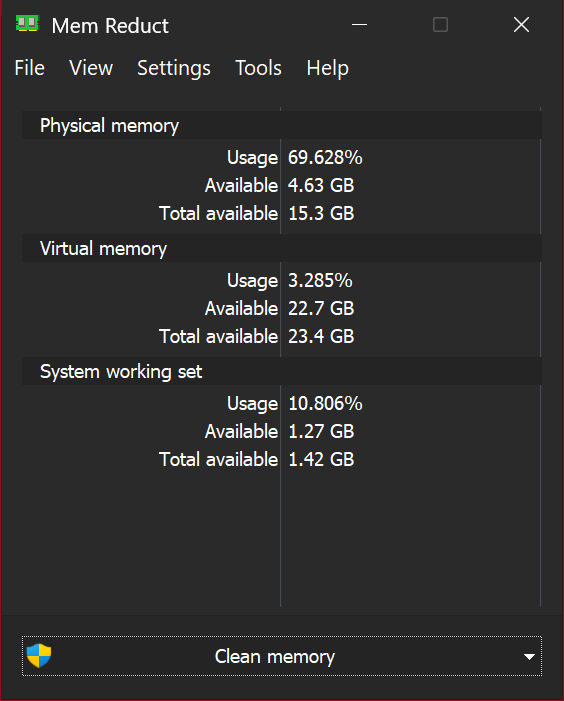

# Mem Reduct — with Tools menu

A fork of [Henry++'s Mem Reduct](https://github.com/henrypp/memreduct) 3.5.1, the lightweight real-time tool for monitoring and cleaning system memory. It adds a **Tools** menu (in the menu bar and the tray right-click menu) that runs maintenance scripts from a `tools` folder next to `memreduct.exe`. A curated set of scripts is included, and anything you drop into the folder appears in the menu without a restart. Memory cleaning itself is unchanged from upstream.

## Installation

**Requirements:** Windows 10 or 11 (x64 or ARM64) and administrator rights.

1. Download the latest build from **[Releases](https://github.com/aiaiaioh/memreduct/releases/latest)**:
   * `memreduct-<version>-setup.exe` — installer (installs the `tools` folder too)
   * `memreduct-tools-x64` — portable folder: unzip anywhere and run `memreduct.exe` (settings stay in `memreduct.ini` beside it)
   
   No release yet? Open **[Actions → build](https://github.com/aiaiaioh/memreduct/actions/workflows/build.yml)**, pick the latest green run, and download the `memreduct-tools-installer` or `memreduct-tools-x64` artifact (requires a GitHub sign-in).
2. Builds are unsigned, so SmartScreen may warn on first run: **More info → Run anyway**. The installer comes with a `.sha256` file if you want to check it.
3. Don't accept **Help → Check for updates**. It points at upstream releases and would replace this build with stock Mem Reduct, which has no Tools menu.

**Build it yourself:** fork the repo and let the [build workflow](.github/workflows/build.yml) run, or open `memreduct.sln` in Visual Studio 2026 with [henrypp/routine](https://github.com/henrypp/routine) checked out as a sibling folder (`..\routine`), then build `Release | x64`.

## Tools menu

| Script | What it does |
|---|---|
| [Clean-Temp-Files.ps1](tools/Clean-Temp-Files.ps1) | Clears user and system temp folders |
| [Cleanup-Component-Store.ps1](tools/Cleanup-Component-Store.ps1) | DISM component store cleanup (WinSxS) |
| [Repair-System-Files.ps1](tools/Repair-System-Files.ps1) | DISM `/RestoreHealth`, then `sfc /scannow` |
| [Reset-Windows-Update-Cache.ps1](tools/Reset-Windows-Update-Cache.ps1) | Standard fix for stuck Windows updates |
| [Flush-Network-Caches.ps1](tools/Flush-Network-Caches.ps1) | Flushes DNS, ARP and NetBIOS caches |

* Supported types: `.ps1`, `.bat`, `.cmd`, `.reg`. Scripts run elevated, and `.reg` files still show regedit's own confirmation prompt.
* A confirmation dialog appears before each run, with a *don't ask again* box.
* **Tools → Open tools folder…** takes you straight to the folder.
* See [tools/README.md](tools/README.md) for how each script was adapted and which windows-cleaner scripts were deliberately left out (one-shot debloat, `chkdsk /r`, and others).

## Links

* [henrypp/memreduct](https://github.com/henrypp/memreduct) — the original Mem Reduct
* [markulie/windows-cleaner](https://github.com/markulie/windows-cleaner) — source of several of the bundled scripts (MIT)
* [henrypp/routine](https://github.com/henrypp/routine) — Henry's support library, required to build

## License

GPL-3.0, same as upstream. Mem Reduct © Henry++; Tools menu by [aiaiaioh](https://github.com/aiaiaioh).
